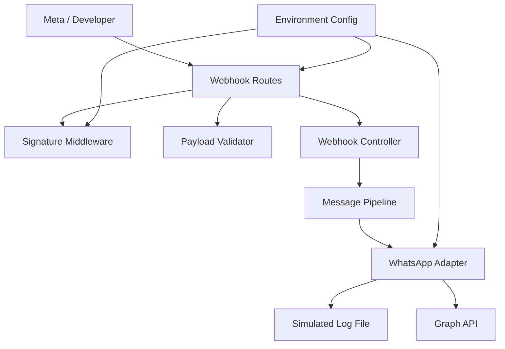
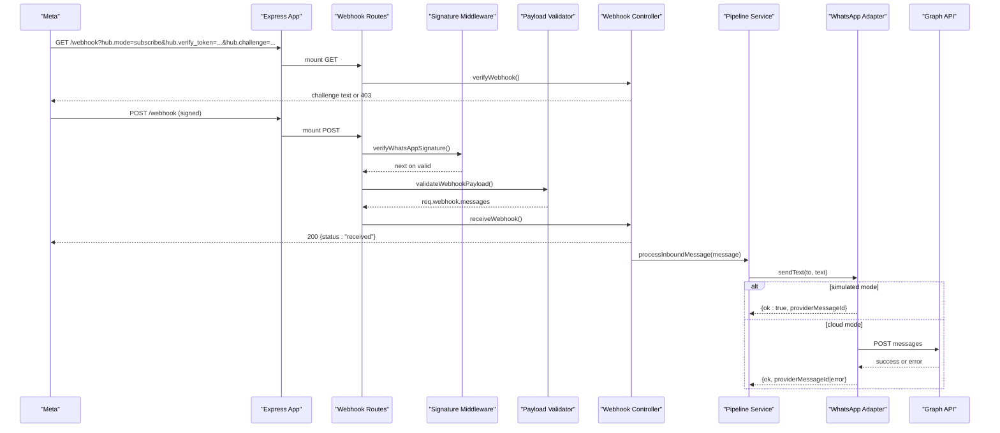
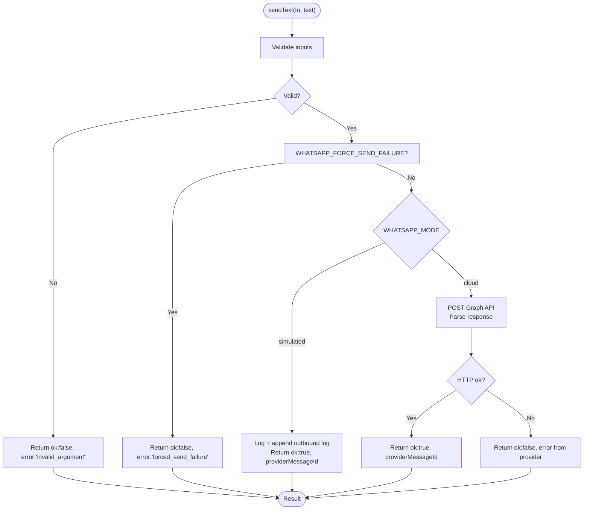
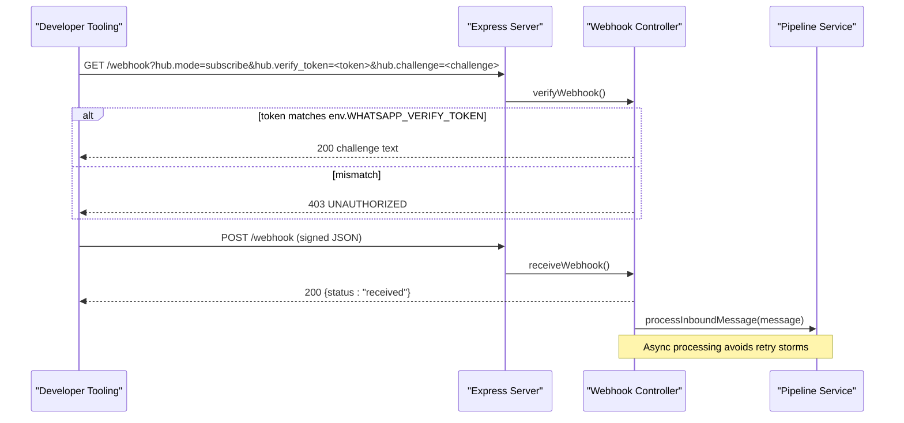
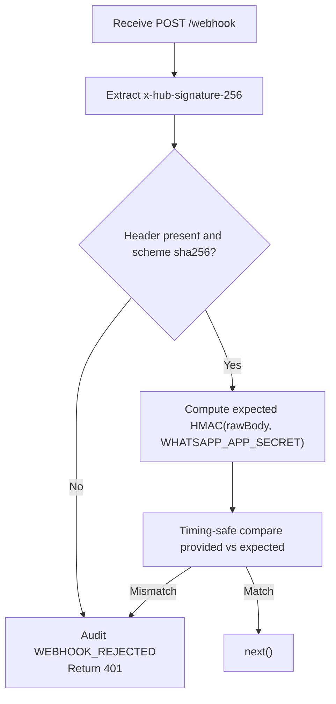
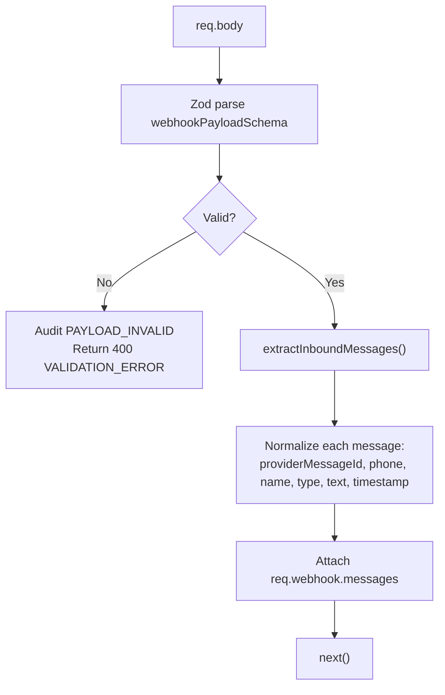
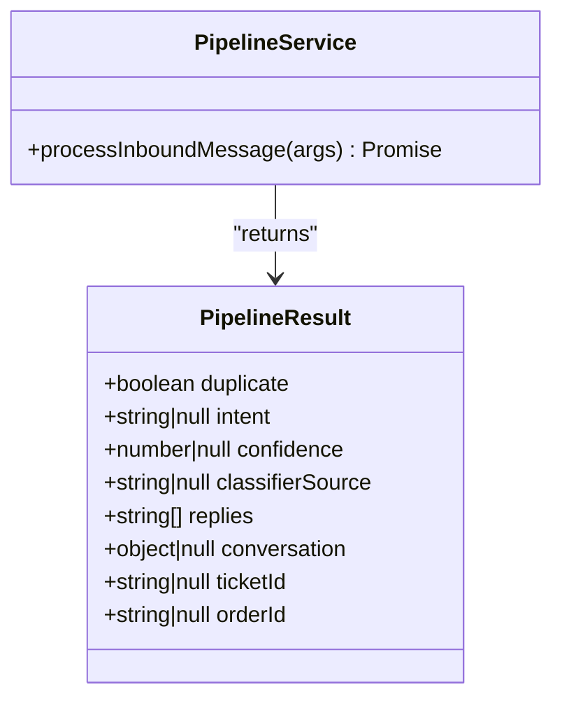
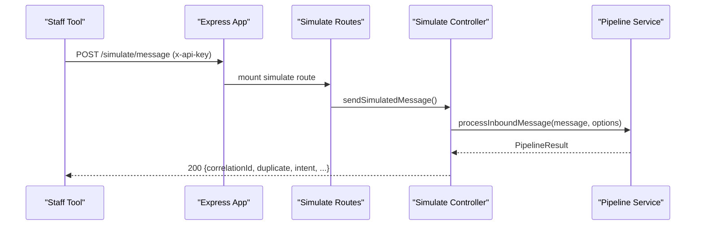
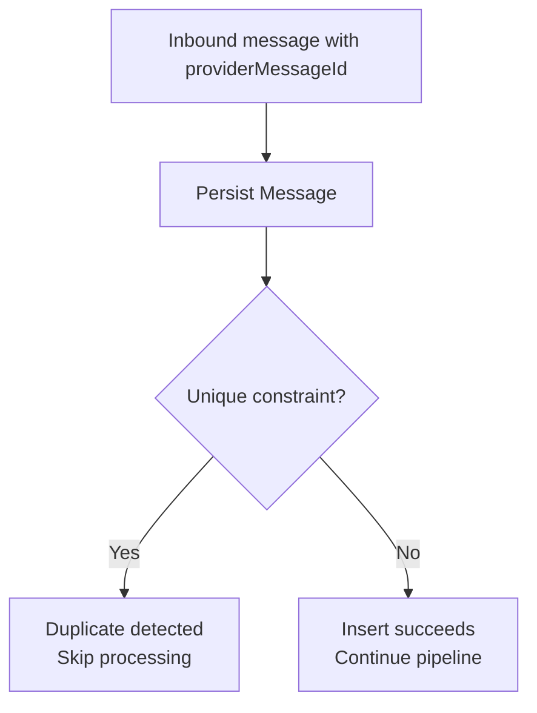
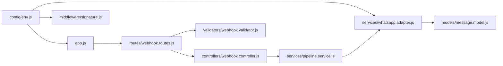

# WhatsApp Integration

<cite>
**Referenced Files in This Document**
- [README.md](file://README.md)
- [src/app.js](file://src/app.js)
- [src/server.js](file://src/server.js)
- [src/config/env.js](file://src/config/env.js)
- [src/controllers/webhook.controller.js](file://src/controllers/webhook.controller.js)
- [src/controllers/simulate.controller.js](file://src/controllers/simulate.controller.js)
- [src/middleware/signature.js](file://src/middleware/signature.js)
- [src/routes/webhook.routes.js](file://src/routes/webhook.routes.js)
- [src/services/whatsapp.adapter.js](file://src/services/whatsapp.adapter.js)
- [src/services/pipeline.service.js](file://src/services/pipeline.service.js)
- [src/validators/webhook.validator.js](file://src/validators/webhook.validator.js)
- [scripts/send-webhook.js](file://scripts/send-webhook.js)
- [test_inputs/webhook-sample.json](file://test_inputs/webhook-sample.json)
- [tests/webhook.test.js](file://tests/webhook.test.js)
- [tests/whatsappAdapter.test.js](file://tests/whatsappAdapter.test.js)
- [src/models/message.model.js](file://src/models/message.model.js)
</cite>

## Table of Contents
1. [Introduction](#introduction)
2. [Project Structure](#project-structure)
3. [Core Components](#core-components)
4. [Architecture Overview](#architecture-overview)
5. [Detailed Component Analysis](#detailed-component-analysis)
6. [Dependency Analysis](#dependency-analysis)
7. [Performance Considerations](#performance-considerations)
8. [Troubleshooting Guide](#troubleshooting-guide)
9. [Conclusion](#conclusion)

## Introduction
This document explains the WhatsApp Business API integration for the Lead System Manager. It covers the dual-mode architecture that supports simulated development and production Cloud API mode, webhook setup and signature verification, message transformation, outbound handling through an adapter pattern, security considerations, rate limiting, retry strategies, and debugging techniques for webhook processing failures.

The system is intentionally designed so that local development does not require a Meta account: in simulated mode, outbound messages are logged rather than sent. Production mode switches to real Graph API calls using configured credentials.

**Section sources**
- [README.md:1-47](file://README.md#L1-L47)
- [README.md:199-243](file://README.md#L199-L243)

## Project Structure
The WhatsApp integration spans controllers, middleware, validators, services, routes, configuration, scripts, tests, and models. The most relevant parts are:

- Webhook entry points and handshake logic
- HMAC-SHA256 signature verification middleware
- Payload validation and normalization into a pipeline-friendly shape
- Message pipeline skeleton
- WhatsApp adapter with simulated and cloud modes
- Environment configuration and validation
- Manual testing script for signed webhooks
- Tests validating webhook behavior and adapter behavior

**Diagram sources**
- [src/routes/webhook.routes.js:1-16](file://src/routes/webhook.routes.js#L1-L16)
- [src/middleware/signature.js:1-51](file://src/middleware/signature.js#L1-L51)
- [src/validators/webhook.validator.js:1-124](file://src/validators/webhook.validator.js#L1-L124)
- [src/controllers/webhook.controller.js:1-56](file://src/controllers/webhook.controller.js#L1-L56)
- [src/services/pipeline.service.js:1-81](file://src/services/pipeline.service.js#L1-L81)
- [src/services/whatsapp.adapter.js:1-136](file://src/services/whatsapp.adapter.js#L1-L136)
- [src/config/env.js:1-130](file://src/config/env.js#L1-L130)

**Section sources**
- [README.md:364-384](file://README.md#L364-L384)
- [src/app.js:1-76](file://src/app.js#L1-L76)
- [src/server.js:1-50](file://src/server.js#L1-L50)

## Core Components
- Dual-mode WhatsApp adapter: simulated logging vs Cloud API sending.
- Webhook endpoints: GET handshake and POST inbound message handler.
- Signature verification middleware: HMAC-SHA256 against raw body.
- Payload validator: Zod schema plus normalization into pipeline messages.
- Message pipeline: skeleton orchestrator for future classification, routing, replies, and persistence.
- Environment configuration: validated settings including WhatsApp mode and secrets.
- Manual webhook sender: signs payloads and posts them locally for testing.

Key responsibilities:
- Controllers accept requests and delegate to services.
- Middleware enforces security and request shaping.
- Validators ensure payload integrity and produce normalized messages.
- Services implement business flow and external integrations.
- Configuration centralizes environment variables and startup rules.

**Section sources**
- [src/services/whatsapp.adapter.js:9-24](file://src/services/whatsapp.adapter.js#L9-L24)
- [src/controllers/webhook.controller.js:5-34](file://src/controllers/webhook.controller.js#L5-L34)
- [src/middleware/signature.js:7-18](file://src/middleware/signature.js#L7-L18)
- [src/validators/webhook.validator.js:7-18](file://src/validators/webhook.validator.js#L7-L18)
- [src/services/pipeline.service.js:3-20](file://src/services/pipeline.service.js#L3-L20)
- [src/config/env.js:25-64](file://src/config/env.js#L25-L64)

## Architecture Overview
The integration follows a layered architecture:

- HTTP layer (Express app): correlation IDs, structured logging, helmet, JSON parsing, rate limiting, route mounting.
- Routing layer: separates webhook GET and POST paths.
- Middleware layer: signature verification and payload validation.
- Controller layer: fast acknowledgment for webhooks; synchronous response for simulate endpoint.
- Service layer: pipeline orchestration and WhatsApp adapter abstraction.
- External systems: Meta Cloud API and optional MongoDB.

**Diagram sources**
- [src/app.js:1-76](file://src/app.js#L1-L76)
- [src/routes/webhook.routes.js:1-16](file://src/routes/webhook.routes.js#L1-L16)
- [src/middleware/signature.js:1-51](file://src/middleware/signature.js#L1-L51)
- [src/validators/webhook.validator.js:1-124](file://src/validators/webhook.validator.js#L1-L124)
- [src/controllers/webhook.controller.js:1-56](file://src/controllers/webhook.controller.js#L1-L56)
- [src/services/pipeline.service.js:1-81](file://src/services/pipeline.service.js#L1-L81)
- [src/services/whatsapp.adapter.js:1-136](file://src/services/whatsapp.adapter.js#L1-L136)

## Detailed Component Analysis

### Dual-Mode WhatsApp Adapter
The adapter abstracts outbound messaging behind a single interface. In simulated mode, it logs messages and writes JSON lines to a file. In cloud mode, it calls the Graph API with bearer authentication and returns structured results indicating success or failure. A test hook can force send failures to exercise downstream error handling.

**Diagram sources**
- [src/services/whatsapp.adapter.js:47-104](file://src/services/whatsapp.adapter.js#L47-L104)
- [src/services/whatsapp.adapter.js:113-135](file://src/services/whatsapp.adapter.js#L113-L135)

Security and reliability notes:
- Cloud sends use an AbortController timeout to avoid hanging requests.
- Provider errors and network failures are captured without throwing, enabling callers to implement retries.
- Phone numbers are converted to WhatsApp ID format before sending.

**Section sources**
- [src/services/whatsapp.adapter.js:1-136](file://src/services/whatsapp.adapter.js#L1-L136)
- [tests/whatsappAdapter.test.js:34-61](file://tests/whatsappAdapter.test.js#L34-L61)
- [tests/whatsappAdapter.test.js:63-118](file://tests/whatsappAdapter.test.js#L63-L118)

### Webhook Handshake and Inbound Processing
The webhook GET endpoint performs Meta’s verification handshake by echoing the challenge when the verify token matches. The POST endpoint verifies signatures, validates the payload, acknowledges immediately, and processes messages asynchronously.

**Diagram sources**
- [src/controllers/webhook.controller.js:5-55](file://src/controllers/webhook.controller.js#L5-L55)
- [src/routes/webhook.routes.js:1-16](file://src/routes/webhook.routes.js#L1-L16)

**Section sources**
- [src/controllers/webhook.controller.js:1-56](file://src/controllers/webhook.controller.js#L1-L56)
- [src/routes/webhook.routes.js:1-16](file://src/routes/webhook.routes.js#L1-L16)
- [tests/webhook.test.js:61-83](file://tests/webhook.test.js#L61-L83)

### HMAC-SHA256 Signature Verification
Incoming POST webhooks must include the `x-hub-signature-256` header. The middleware computes HMAC-SHA256 over the raw request body using the configured app secret and compares it using a timing-safe comparison. Rejections are audited before returning 401.

**Diagram sources**
- [src/middleware/signature.js:19-50](file://src/middleware/signature.js#L19-L50)

Operational details:
- The Express JSON parser stores the raw buffer for signature verification.
- Missing or malformed headers result in an audit event and 401.
- Invalid signatures are rejected and audited.

**Section sources**
- [src/middleware/signature.js:1-51](file://src/middleware/signature.js#L1-L51)
- [src/app.js:41-50](file://src/app.js#L41-L50)
- [tests/webhook.test.js:99-130](file://tests/webhook.test.js#L99-L130)

### Webhook Payload Validation and Normalization
The validator uses a permissive Zod schema to accept Meta’s evolving payload while ensuring required fields exist. It extracts inbound messages and normalizes them into a pipeline-friendly structure, including phone normalization and text extraction.

**Diagram sources**
- [src/validators/webhook.validator.js:53-95](file://src/validators/webhook.validator.js#L53-L95)
- [src/validators/webhook.validator.js:103-123](file://src/validators/webhook.validator.js#L103-L123)

**Section sources**
- [src/validators/webhook.validator.js:1-124](file://src/validators/webhook.validator.js#L1-L124)
- [tests/webhook.test.js:132-148](file://tests/webhook.test.js#L132-L148)

### Message Pipeline Skeleton
The pipeline service currently accepts normalized messages, logs them, and returns a stable result shape. Future tasks will add deduplication, conversation loading, intent classification, reply generation, ticketing, and outbound messaging.

**Diagram sources**
- [src/services/pipeline.service.js:21-30](file://src/services/pipeline.service.js#L21-L30)
- [src/services/pipeline.service.js:42-80](file://src/services/pipeline.service.js#L42-L80)

**Section sources**
- [src/services/pipeline.service.js:1-81](file://src/services/pipeline.service.js#L1-L81)

### Simulate Endpoint
The simulate endpoint drives the same pipeline synchronously for manual testing and demos. It requires staff API key protection and is disabled in production by design.

**Diagram sources**
- [src/controllers/simulate.controller.js:1-35](file://src/controllers/simulate.controller.js#L1-L35)
- [src/services/pipeline.service.js:42-80](file://src/services/pipeline.service.js#L42-L80)

**Section sources**
- [src/controllers/simulate.controller.js:1-35](file://src/controllers/simulate.controller.js#L1-L35)
- [README.md:319-344](file://README.md#L319-L344)

### Meta App Configuration and Webhook Subscription
To connect real WhatsApp traffic:

- Create a Meta Business app and add the WhatsApp product.
- Record the Phone number ID and temporary access token for initial testing.
- Retrieve the App Secret for signature verification.
- Choose a Verify Token and configure it in both `.env` and Meta’s webhook configuration.
- Expose your server publicly via HTTPS using ngrok.
- Set the Callback URL and Verify Token in Meta’s WhatsApp configuration.
- Subscribe to the `messages` field.
- Switch `WHATSAPP_MODE=cloud` to enable real Graph API sends.
- For long-term operation, generate a permanent access token with the correct permission.

**Section sources**
- [README.md:199-243](file://README.md#L199-L243)

### Outbound Message Handling and Retry Strategy
The adapter returns structured results instead of throwing exceptions. Callers should treat `ok:false` as a signal to retry with backoff, especially for transient network or provider errors. The forced-failure flag helps validate this path during testing.

Recommended strategy:
- On `ok:false`, inspect the error string.
- Retry transient errors (network timeouts, rate limits) with exponential backoff.
- Do not retry invalid arguments or permanent configuration errors.
- Persist failed attempts and alert operators if retries exceed thresholds.

**Section sources**
- [src/services/whatsapp.adapter.js:60-104](file://src/services/whatsapp.adapter.js#L60-L104)
- [src/services/whatsapp.adapter.js:123-131](file://src/services/whatsapp.adapter.js#L123-L131)
- [tests/whatsappAdapter.test.js:96-118](file://tests/whatsappAdapter.test.js#L96-L118)

### Deduplication and Persistence
Deduplication is implemented at the database level using a unique index on `providerMessageId`. When the same message arrives again due to provider retries, the second insert fails with a duplicate-key error. This provides a robust backstop even if application-level dedupe is added later.

**Diagram sources**
- [src/models/message.model.js:6-12](file://src/models/message.model.js#L6-L12)
- [src/models/message.model.js:22-23](file://src/models/message.model.js#L22-L23)

**Section sources**
- [src/models/message.model.js:1-35](file://src/models/message.model.js#L1-L35)

## Dependency Analysis
The following diagram shows how components depend on each other for WhatsApp integration.

**Diagram sources**
- [src/config/env.js:1-130](file://src/config/env.js#L1-L130)
- [src/app.js:1-76](file://src/app.js#L1-L76)
- [src/routes/webhook.routes.js:1-16](file://src/routes/webhook.routes.js#L1-L16)
- [src/middleware/signature.js:1-51](file://src/middleware/signature.js#L1-L51)
- [src/validators/webhook.validator.js:1-124](file://src/validators/webhook.validator.js#L1-L124)
- [src/controllers/webhook.controller.js:1-56](file://src/controllers/webhook.controller.js#L1-L56)
- [src/services/pipeline.service.js:1-81](file://src/services/pipeline.service.js#L1-L81)
- [src/services/whatsapp.adapter.js:1-136](file://src/services/whatsapp.adapter.js#L1-L136)
- [src/models/message.model.js:1-35](file://src/models/message.model.js#L1-L35)

**Section sources**
- [src/app.js:1-76](file://src/app.js#L1-L76)
- [src/routes/webhook.routes.js:1-16](file://src/routes/webhook.routes.js#L1-L16)

## Performance Considerations
- Rate limiting: coarse abuse protection is enabled outside tests, returning 429 with a standard error shape.
- Logging: structured pino logging with correlation IDs aids tracing across layers.
- Webhook latency: immediate 200 prevents retry storms; heavy work runs asynchronously.
- Cloud API timeout: outbound Graph API calls abort after a fixed duration to prevent resource leaks.
- Database resilience: the server starts even if MongoDB is down; `/health` reports degraded until recovery.

Recommendations:
- Tune rate limit windows and thresholds based on expected Meta retry patterns.
- Monitor outbound log growth in simulated mode.
- Track Graph API error rates and adjust retry policies accordingly.
- Use correlation IDs to trace requests end-to-end in logs and audits.

**Section sources**
- [src/app.js:21-67](file://src/app.js#L21-L67)
- [src/server.js:20-26](file://src/server.js#L20-L26)
- [src/services/whatsapp.adapter.js:26-27](file://src/services/whatsapp.adapter.js#L26-L27)

## Troubleshooting Guide
Common issues and resolutions:

- Startup rejects default secrets: replace placeholders in `.env`; production refuses default values.
- `/health` returns 503: MongoDB is unreachable; start Mongo or fix connection string.
- Port conflict: change `PORT` in `.env`.
- Webhook POST returns 401: verify `WHATSAPP_APP_SECRET` and that the signature was computed over the exact raw body.
- Handshake returns 403: ensure `WHATSAPP_VERIFY_TOKEN` matches between `.env` and Meta’s webhook configuration.
- Force send failures: set `WHATSAPP_FORCE_SEND_FAILURE=true` to exercise notifier failure paths.
- Testing signed webhooks locally: use the provided script to sign and post sample payloads.

Debugging tips:
- Inspect audit events for `WEBHOOK_REJECTED` and `PAYLOAD_INVALID`.
- Check `logs/whatsapp-outbound.log` for simulated outbound messages.
- Use correlation IDs to trace requests across logs and audits.
- Run the webhook tests to validate signature and payload behavior.

**Section sources**
- [README.md:409-420](file://README.md#L409-L420)
- [src/middleware/signature.js:23-30](file://src/middleware/signature.js#L23-L30)
- [src/validators/webhook.validator.js:103-118](file://src/validators/webhook.validator.js#L103-L118)
- [scripts/send-webhook.js:1-84](file://scripts/send-webhook.js#L1-L84)
- [tests/webhook.test.js:85-168](file://tests/webhook.test.js#L85-L168)

## Conclusion
This integration provides a secure, extensible foundation for WhatsApp messaging. The adapter pattern cleanly separates simulated development from production Cloud API usage. Webhook security is enforced with HMAC-SHA256 verification and strict payload validation. The asynchronous controller design protects against retry storms, while structured results from the adapter enable robust retry and error-handling strategies. With environment-driven configuration, audit trails, and comprehensive tests, the system is ready for iterative enhancement toward full classification, order handling, and staff notifications.